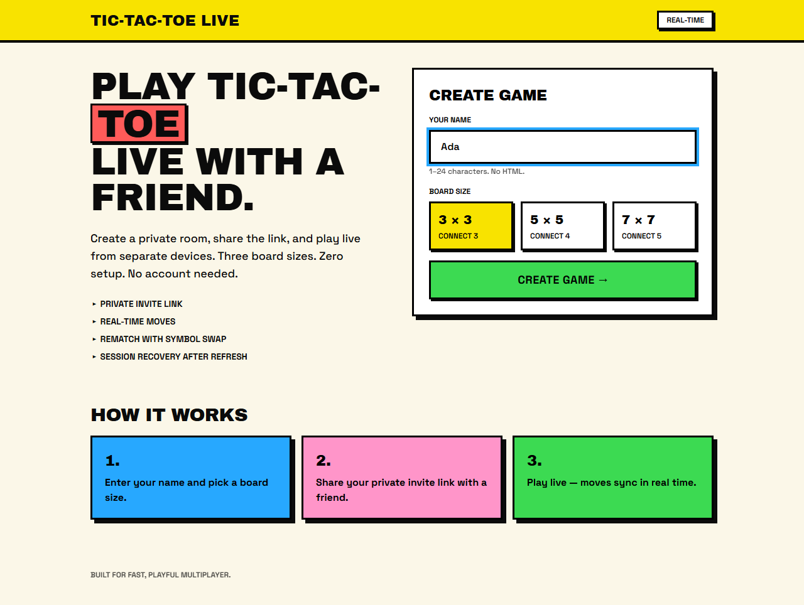
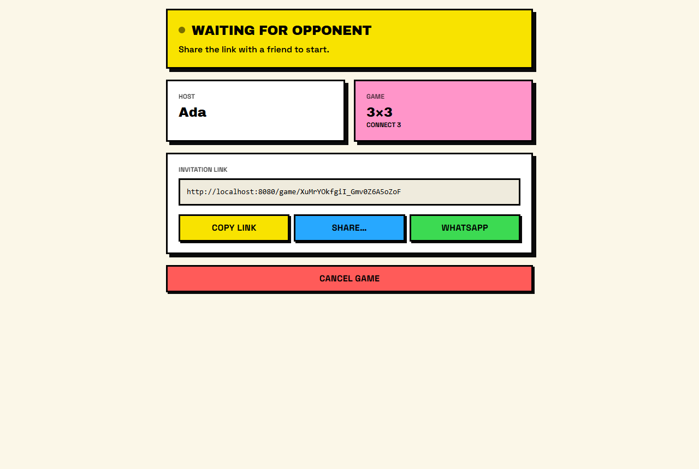
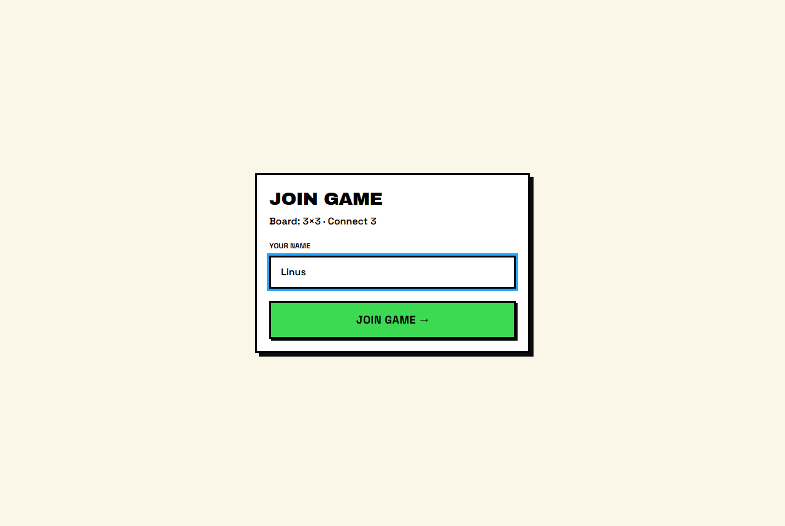
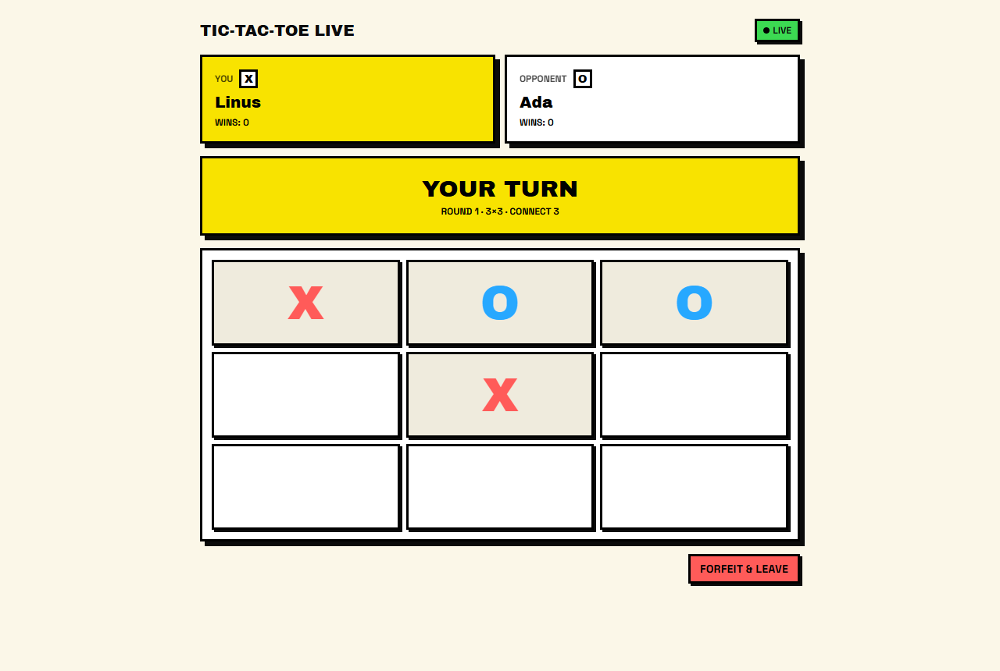
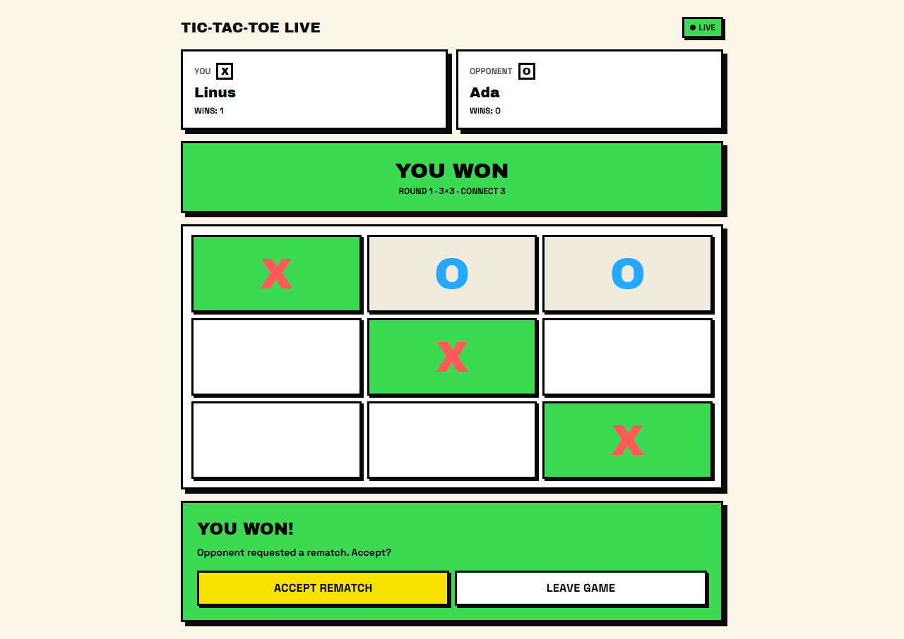
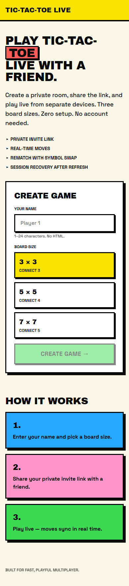

# Tic-Tac-Toe Live

Real-time multiplayer Tic-Tac-Toe in the browser. Create a private room, send the link to a friend,
and play live from separate devices — no accounts, no installs. Choose a classic 3×3 board or the
bigger 5×5 and 7×7 variants.



## Features

- **Private rooms** — each game gets an unguessable invite link (`/game/<room-token>`).
- **Three board sizes** — 3×3 (connect 3), 5×5 (connect 4), 7×7 (connect 5).
- **Real-time moves** — both players' screens update as soon as a move is made.
- **Server-side rules** — turn order, move validation, and win/draw detection run in the database,
  so a client can't cheat by editing the page.
- **Rematches with symbol swap** — play again in the same room; X and O swap each round and a win
  counter tracks the session score.
- **Session recovery** — refresh or reopen the link and you're back in your seat.
- **Easy sharing** — copy link, native share sheet, or WhatsApp.
- **Forfeit / cancel** — leave mid-game (opponent wins the round) or cancel a room nobody joined.
- **Mobile-friendly**, keyboard-accessible board, and reduced-motion support.

## Screenshots

| Waiting for an opponent | Joining from the invite link |
| --- | --- |
|  |  |
| **Playing a round** | **Winning line and rematch request** |
|  |  |

<p align="center">
  
  <br /><em>Home page on a phone</em>
</p>

*Screenshots were captured from a local development build playing a real game against the
project's Supabase backend.*

## How it works

1. **Create** — the host enters a name and picks a board size. The app creates a room and keeps a
   random private session token in the browser's `localStorage`; only its SHA-256 hash is stored on
   the server.
2. **Share** — the host sends the invite link. The room waits up to 30 minutes for an opponent.
3. **Join** — the second player opens the link and enters a name. The server randomly assigns X
   (who moves first) and starts round 1.
4. **Play** — each move is sent to a database function that checks it's your turn, the cell is free,
   and your view isn't out of date, then records the move and checks for a win or draw.
5. **Sync** — both browsers subscribe to database changes for the room through Supabase Realtime and
   refresh their view when anything changes.
6. **Rematch** — when both players ask for a rematch, a new round starts with symbols swapped.

```text
Browser (React, TanStack Start)
   │  create / join / move / rematch / leave / heartbeat  ──►  Supabase Postgres functions
   │                                                            (all game rules, SECURITY DEFINER)
   └──◄  Realtime change events (rooms, players, rounds)  ◄──  game tables
```

## Tech stack

| Layer | Technology |
| --- | --- |
| Framework | [TanStack Start](https://tanstack.com/start) (React 19, file-based routing, SSR) |
| Build | Vite 8 with `@lovable.dev/vite-tanstack-config`, nitro |
| Styling | Tailwind CSS v4 with a custom neo-brutalist theme (`src/styles.css`, `src/components/neo/`) |
| Backend | Supabase — Postgres (tables + PL/pgSQL functions), Row Level Security, Realtime |
| Notifications | sonner toasts |
| Language | TypeScript (strict) |

## Getting started

### Prerequisites

- Node.js (with npm) — or [Bun](https://bun.sh); both lockfiles are committed.
- A Supabase project with the migrations from `supabase/migrations/` applied. The Lovable-connected
  project is already set up.

### Environment variables

The app reads these from `.env` (values are not shown here):

| Variable | Used for |
| --- | --- |
| `VITE_SUPABASE_URL` | Supabase project URL (browser) |
| `VITE_SUPABASE_PUBLISHABLE_KEY` | Supabase publishable / anon key (browser) |
| `SUPABASE_URL`, `SUPABASE_PUBLISHABLE_KEY` | Server-side fallbacks for the same values |

The publishable key is meant to be public. Never put a service-role key or other secret in `.env`,
because the file is committed to the repository.

### Run locally

```sh
git clone <this-repository-url>
cd tik-tak-toe
npm install
npm run dev
```

Open <http://localhost:8080>. To play against yourself, open the invite link in a second browser
or a private window — each browser profile counts as a separate player.

### Scripts

| Command | What it does |
| --- | --- |
| `npm run dev` | Start the development server |
| `npm run build` | Production build |
| `npm run build:dev` | Build in development mode |
| `npm run preview` | Serve the production build locally |
| `npm run lint` | Run ESLint (includes Prettier checks) |
| `npm run format` | Format all files with Prettier |

There is no automated test suite yet.

## Project structure

```text
src/
├── routes/
│   ├── __root.tsx            # HTML shell, meta tags, fonts, toaster, 404 and error pages
│   ├── index.tsx             # Home page and "Create Game" form
│   └── game.$roomToken.tsx   # Join, waiting room, board, results and rematch
├── components/neo/           # NeoButton, NeoCard, NeoInput — the app's UI kit
├── hooks/useRoomRealtime.ts  # Loads room state and listens for realtime changes
├── lib/game/
│   ├── api.ts                # Calls to the Supabase game functions + friendly error messages
│   ├── session.ts            # Private session token and session id in localStorage
│   └── types.ts              # Game types and board configurations
├── integrations/supabase/    # Generated Supabase client and types (do not edit)
├── styles.css                # Tailwind theme and neo-brutalist utilities
├── server.ts, start.ts, router.tsx   # SSR entry, middleware, router setup
supabase/migrations/          # Database schema, security rules and game functions
docs/screenshots/             # Images used in this README
```

`src/components/ui/` contains shadcn/ui components from the project template. The app doesn't
currently use them.

## Database

| Table | Holds |
| --- | --- |
| `game_rooms` | Room token, status (`waiting` → `active` → `completed`, or `cancelled` / `expired`), board size, current round, rematch request, expiry |
| `player_sessions` | The two players: name, position, symbol, connection status, session wins, hashed private token |
| `game_rounds` | Board state, whose turn it is, turn number, result and winning cells |
| `game_moves` | Every move made, with a client action id |

Clients can only **read** these tables (the hashed token column is hidden). All changes go through
database functions: `create_game_room`, `join_game_room`, `make_move`, `request_rematch`,
`leave_room`, `heartbeat`, and `get_room_by_token`.

To change the schema, add a new migration file. Don't edit existing ones.

## Known limitations

- Game pages fail server-side rendering (they read `localStorage` during render) and fall back to
  client rendering. The game works, but those pages aren't server-rendered.
- The "opponent reconnecting" status is never triggered, because the server only tracks
  connected/left.
- Rooms expire only when someone tries to join them; there is no cleanup job.

See [MASTER.md](MASTER.md) for the full list, including suspected issues still to be verified.

## Built with Lovable

This project is connected to [Lovable](https://lovable.dev). Changes made in the Lovable editor are
committed to this repository, and commits pushed to `main` sync back to Lovable. Avoid rewriting
pushed history (force-push, rebase, amend, squash), as it breaks the Lovable project history.

## Further documentation

- [MASTER.md](MASTER.md) — detailed architecture, behavior, known issues, and change history.
- [AGENTS.md](AGENTS.md) — rules for AI coding agents working in this repository.
- [src/routes/README.md](src/routes/README.md) — file-based routing conventions.
